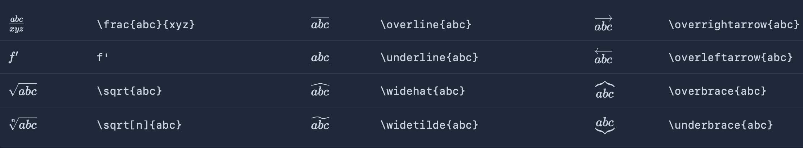
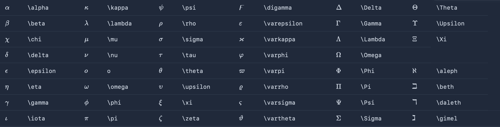
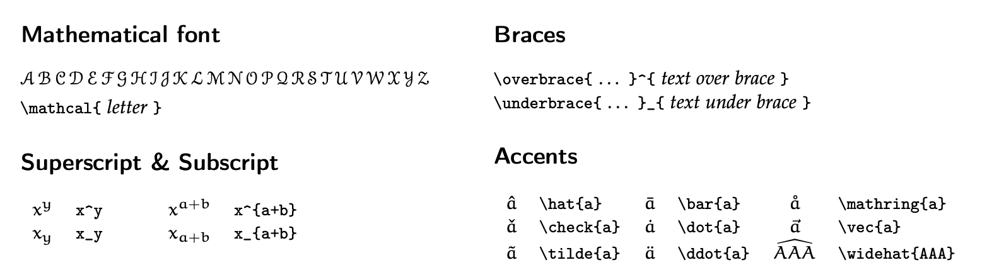
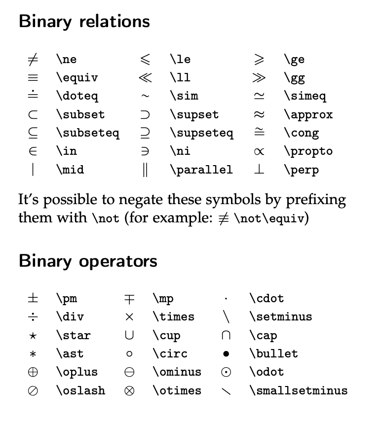

# Introduction to LaTex

I will provide a crash course on how to use LaTex to create mathematical equations. Kemp, et al. (2016) discuss how LaTeX is the “industry standard” typesetting system for writing mathematics. LaTeX is more flexible than standard word processors, such as MSWord), produces vastly better-looking results.

Learning how to create mathematical equations with LaTex will help you with your homework and projects through the empirical sequence.

With LaTex, we can turn y=bx^2+c into $$ y=\beta x^2 + c $$  

If you want a mean, you don't have to type mu or average. Just use LaTex by entering "\\\ mu" which results in \( \mu \). Do you want to expected value of x? You can just use E(x), but it looks better with LaTex with \( E(x) \).

## How to use mathematical symbols

We typicall use the "\\\" to initate a mathemetical symbol. We can use "^" for superscripts and "_" for subscripts. For example, we can type \\\ sum^N_{i=1} x_{i} and it will become $$ \sum^N_{i=1} x_{i} $$

You may have noticed that the subscripts had {} brackets. When we want to include an equation in the subscript or subscript, we need to include {} brackets, such as x^{2a+3b}. This will result in \( x^{2a+3b} \)

## Overview of mathematical symbols

I think the following is a helpful reference guide for mathematical symbols in LaTex

Source: https://quickref.me/latex.html

## Greek letters 

Source: https://quickref.me/latex.html

## Accents and Braces

Source: https://www.tilburgsciencehub.com/topics/research-skills/templates-dynamic-content/templates/amsmath-latex-cheatsheet/

## Binary Relations and Operators

Source: https://www.tilburgsciencehub.com/topics/research-skills/templates-dynamic-content/templates/amsmath-latex-cheatsheet/