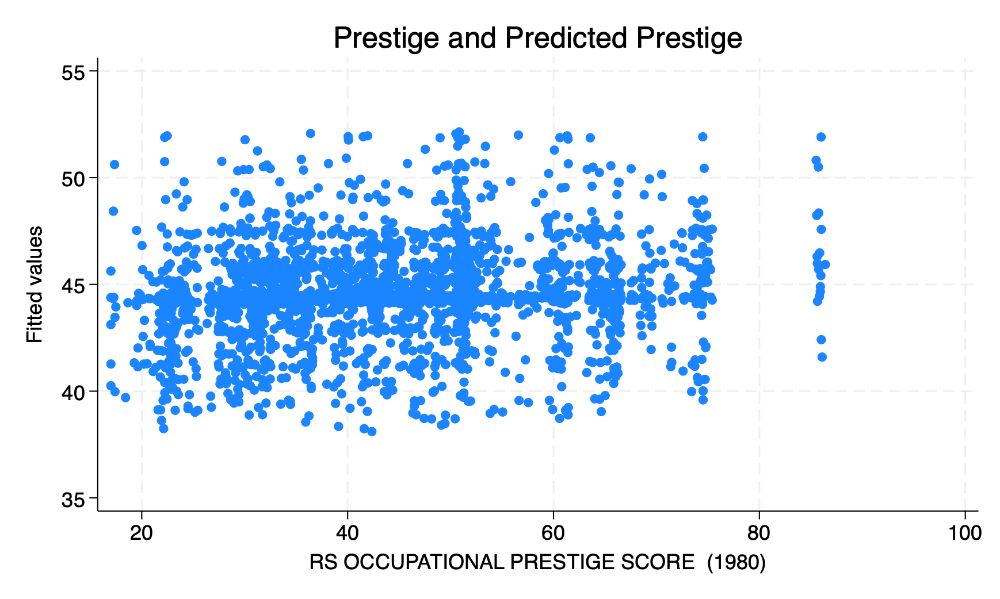
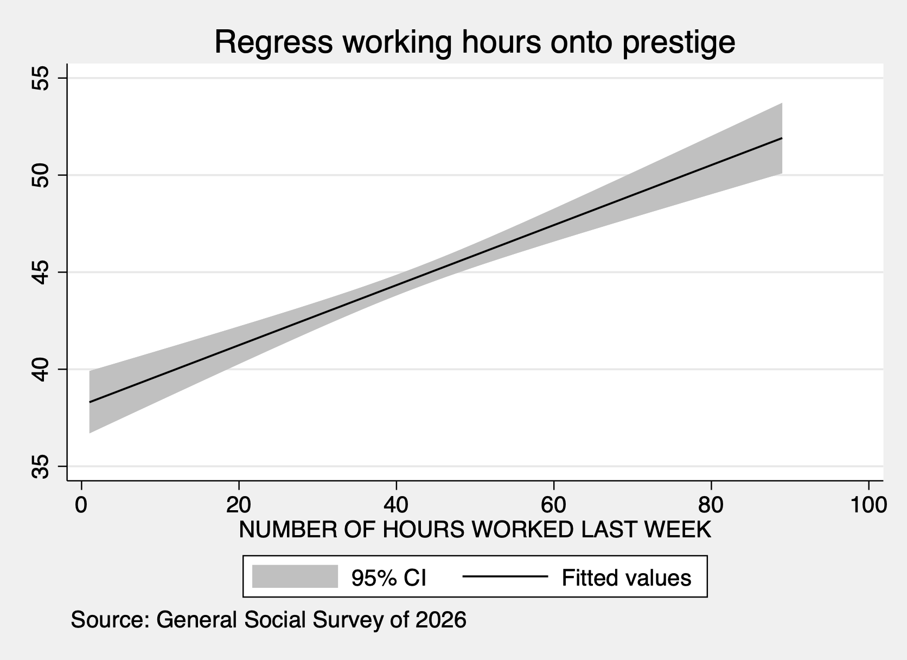
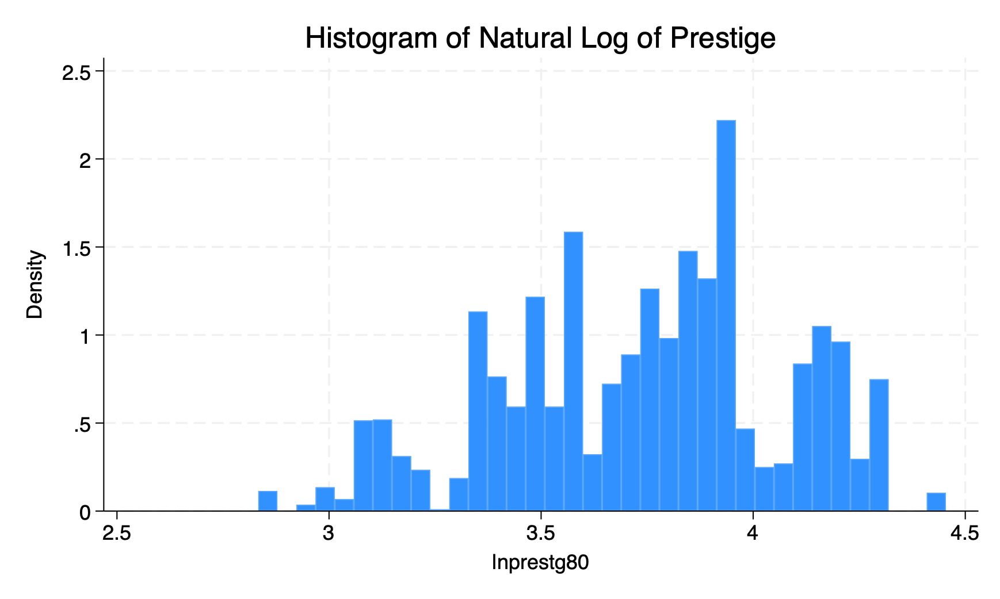
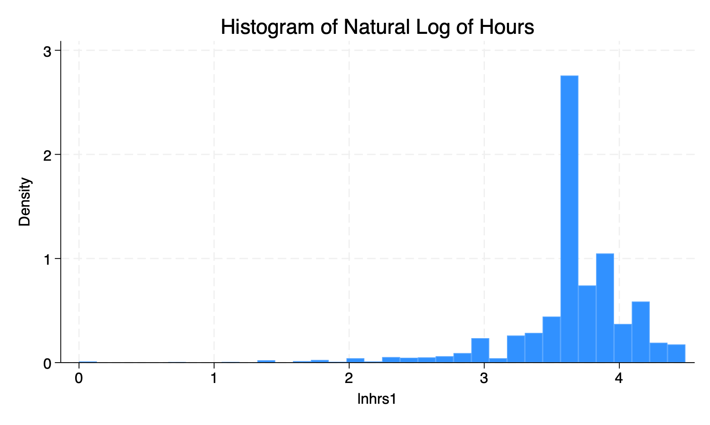

# Simple Linear Regression in Stata

Our model for a simple bivariate linear regression is the following:

$$ y_i = \beta_0 + \beta_1 x_i + \varepsilon_i$$

## Simple Linear Regression Model

Using the 2006 General Social Survey, we will look at the association between occupational prestige and hours worked. We will set up our bivariate linear regression model as the following:

$$ prestige80_i=\beta_0 + \beta_1 hrs_i + \varepsilon_i $$

### Set up your null hypothesis

Next, we will set up a null hypothesis:

$$ H_{0}: \beta_1 = 0 $$

$$ H_{a}: \beta_1 \neq 0 $$

Notice for that this will use a two-tailed test instead of a one tailed test. We can set \(\alpha=0.05\), so we will need to look up the critical \(t\) value for \(t_{0.05/2}\) or \(t_{0.025}\). 

### Descriptive Statistics

First, let's look at the descriptive statistics 

```{stata reg1}
cd "/Users/Sam/Desktop/Econ 643/AGIS/"
use gss2006_chapter8_selected, clear
summarize prestg80 hrs1
```

We can see that the dependent variable's mean is 44.2 with a standard deviation of 14.0 and its range is \([17, 86]\). The independent variable's mean is 42.1 hours with a standard deviation of 14.2 hours and its range is \([1,89]\) hours per week.

**Note:** There are 4,270 observations with occupational prestige, but only 2,739 have reported hours per week.

### Simple Bivariate Linear Regression

Next, we will use the **regress** command to run a linear regression. We use **regress \(y\) \(x\)** to regress \(y\) onto \(x\).

```{stata reg3, eval=FALSE}
regress prestg80 hrs1
```

```{stata reg3_1, echo=FALSE}
quietly {
  cd "/Users/Sam/Desktop/Econ 643/AGIS/"
  use gss2006_chapter8_selected, clear
}
regress prestg80 hrs1
```

Let's look at these results. We see that:

$$ \hat{y} = 38.1 + 0.155x $$

### Look up the Critical Values

First, let's find our sample size and get our degrees of freedom. We see that \(n=2,715\) and our \(df=2,714\), so our \(t_{0.025} \approx 1.96\)

### Test the Null Hypothesis

From our Stata output, we can see that \(t=8.21\) and \(p=0.000\). 

Using the rejection rule with critical \(t\) values, we see that \(8.21 > 1.96\), so we reject the null hypothesis at the \(5\%\) level.

Using the rejection rule with \(p\)-values, we see that \(0.000<0.05\), so we reject the null hypothesis at the \(5\%\) level and conclude that \(\beta_1\) does not equal 0. Furthermore, our \(p\)-value shows that we would reject the null hypothesis at the \(0.1\%\) level, as well.

### Goodness of Fit and Sum of Squares

We can see our goodness of fit is \(R^2=0.024\) or variation in hours explains \(2.4\%\) of the variation in prestige. 

Recall that \(R^2=SSE/SST\) or \(R^2=SSR/SST\). 

We can see this where \(R^2=\frac{13125.035}{542026.259}=0.024\) or \(R^2=1-\frac{528901.224 }{542026.259}=0.024\).

### Overall Model

One thing we haven't covered is the \(F\) test statistic. This test statistics shows how the model compares to no model (just an intercept). So, our null hypothesis is that no model is better than our current model. Looking at the \(p\)-value below the \(F\) test statistic, we reject the null hypothesis at the \(0.1\%\) level.

## Predicted \(y\) and Graph Predicted \(y\)

We can use the post-estimation command **predict** to calculate fitted values of \(y\), which we will call \(\hat{y}\)

We cannot predict \(\hat{y}\) with the *predict* command without the *regress* command. The *predict* command is a post-estimation command, which means that it must come after a *regress* command.

```{stata reg31, eval=FALSE}
predict yhat
```

```{stata reg31_1, echo=FALSE}
quietly {
  cd "/Users/Sam/Desktop/Econ 643/AGIS/"
  use gss2006_chapter8_selected, clear
  regress prestg80 hrs1
}
predict yhat
```

Let's compare \(y\) and \(\hat{y}\) with a scatter plot.

```{stata reg32, eval=FALSE}
scatter yhat prestg80, jitter(2) title("Prestige and Predicted Prestige")
```



We can use a **twoway** using a **lfitci** line graph. The *lfitci* will produce a simple bivariate linear regression between prestige and hours. It will also plot the confidence interval around the regression line.

```{stata reg4, eval=FALSE}
twoway (lfitci prestg80 hrs1), scheme(s2mono) title("Regress working hours onto prestige") caption("Source: General Social Survey of 2026")
```




## Interpretations

We have four way to interpret a simple linear regression depending on the transformation of the dependent or independent variable.

  1. Linear-linear model
  2. Log-linear model.
  3. Linear-log model.
  4. Log-Log model
  
First we need to create our natural log transformations of \(x\) and \(y\). We can use the **ln** function in Stata.

```{stata reg5, echo=FALSE}
quietly {
  cd "/Users/Sam/Desktop/Econ 643/AGIS/"
  use gss2006_chapter8_selected, clear
}
gen lnhrs1=.
replace lnhrs1=ln(hrs1) 
replace lnhrs1 = 0 if hrs1==0
gen lnprestg80=.
replace lnprestg80=ln(prestg80)
replace lnprestg80 = 0 if prestg80==0
summarize lnhrs1 lnprestg80
```

Let's inspect the natural log transformation of prestige. 

```{stata histogram1, eval=FALSE}
histogram lnprestg80, title("Histogram of Natural Log of Prestige")
```



Next, let's inspect the natural log transformation of hours worked.

```{stata histogram2, eval=FALSE}
histogram lnhrs1, title("Histogram of Natural Log of Hours")
```



### Linear-Linear Model

$$ y_i = \beta_0 + \beta_1 x_i + \varepsilon_i $$

Let's rerun our linear-linear model and recall that \(\Delta y = \beta_1 \Delta x_1 \), so we interpret \(\beta_1\) as a one-unit increase in \(x\) leads to a \(\beta_1\) increase in \(y\).

```{stata reg61, eval=FALSE}
regress prestg80 hrs1
```

```{stata reg61_1, echo=FALSE}
quietly {
  cd "/Users/Sam/Desktop/Econ 643/AGIS/"
  use gss2006_chapter8_selected, clear
}
regress prestg80 hrs1
```

We reject the null hypothesis that \(H_0: \beta_1 = 0\) at the 0.1% level and we interpret this as a \(1\) hour increase is **associated** with a 0.155 increase in prestige. 

Question: what does \(\beta_0\) represent?

### Linear-Log Model

$$ y_i = \beta_0 + \beta_1 ln(x_i) + \varepsilon_i $$

Let's run a linear-log model where the dependent variable is not log transformed but the independent variable is log transformed.

We interpret \(\beta_1\) as a \(1\%\) increase in \(x\) is associated with a \(\frac{\beta_1}{100}\) increase in \(y\)

```{stata reg6, eval=FALSE}
regress prestg80 lnhrs1
```

```{stata reg6_1, echo=FALSE}
quietly {
  cd "/Users/Sam/Desktop/Econ 643/AGIS/"
  use gss2006_chapter8_selected, clear
gen lnhrs1=.
replace lnhrs1=ln(hrs1) 
replace lnhrs1 = 0 if hrs1==0
gen lnprestg80=.
replace lnprestg80=ln(prestg80)
replace lnprestg80 = 0 if prestg80==0
}
regress prestg80 lnhrs1
```

We reject the null hypothesis that \(H_0: \beta_1 = 0\) at the 0.1% level and we interpret this as a \(1\%\) increase in hours is associated with a \(\frac{4.12}{100}=0.0412\) increase in prestige. 

### Log-Linear Model

$$ ln(y_i) = \beta_0 + \beta_1 x_i + \varepsilon_i $$

Let's run a log-linear model, where the dependent variable is log transformed but the independent variable is not log transformed.

We interpret this as a interpret \(\beta_1\) as a 1-unit increase in \(x\) is associated with a \( (e^{\beta_{1}}-1)*100 \% \) increase in \(y\).

```{stata reg7, eval=FALSE}
regress lnprestg80 hrs1
```

```{stata reg7_1, echo=FALSE}
quietly {
  cd "/Users/Sam/Desktop/Econ 643/AGIS/"
  use gss2006_chapter8_selected, clear
gen lnhrs1=.
replace lnhrs1=ln(hrs1) 
replace lnhrs1 = 0 if hrs1==0
gen lnprestg80=.
replace lnprestg80=ln(prestg80)
replace lnprestg80 = 0 if prestg80==0
}
regress lnprestg80 hrs1
```

We reject the null hypothesis that \(H_0: \beta_1 = 0\) at the 0.1% level and we interpret that a 1-unit increase in hours is **associated** with a \( (e^{.0037871}-1)*100 \% = .38\% \) increase in occupational prestige.

### Log-Log Model

With a log-log model, we interpret A 1% increase in years of education is associated with a 𝛽_1% change in wages


$$ ln(y_i) = \beta_0 + \beta_1 ln(x_i) + \varepsilon_i $$

We interpret \(\beta\) as a 1% increase in \(x\) is associated with a \(\beta_1\%\) change in \(y\).

```{stata reg8, eval=FALSE}
regress lnprestg80 lnhrs1
```

```{stata reg8_1, echo=FALSE}
quietly {
  cd "/Users/Sam/Desktop/Econ 643/AGIS/"
  use gss2006_chapter8_selected, clear
gen lnhrs1=.
replace lnhrs1=ln(hrs1) 
replace lnhrs1 = 0 if hrs1==0
gen lnprestg80=.
replace lnprestg80=ln(prestg80)
replace lnprestg80 = 0 if prestg80==0
}
regress lnprestg80 lnhrs1
```

We reject the null hypothesis that \(H_0: \beta_1 = 0\) at the 0.1% level and we interpret this as a \(1\%\) increase in hours is associated with a \(0.1\%\) increase in occupational prestige.